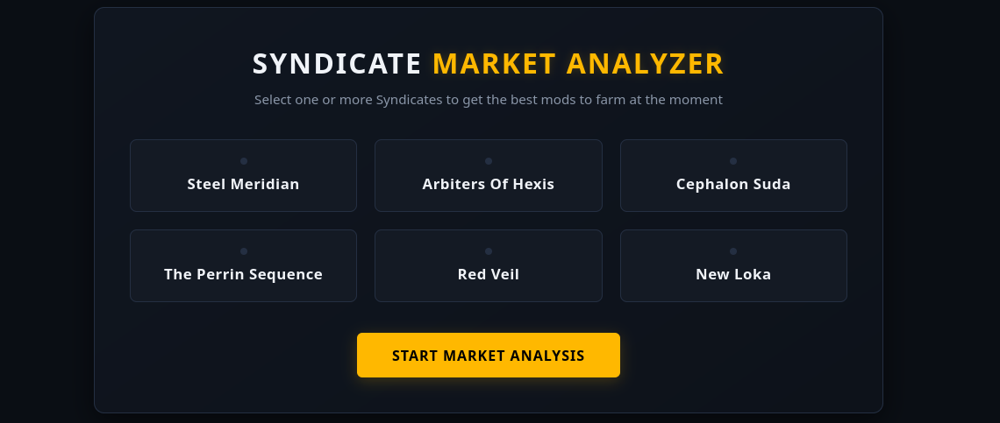
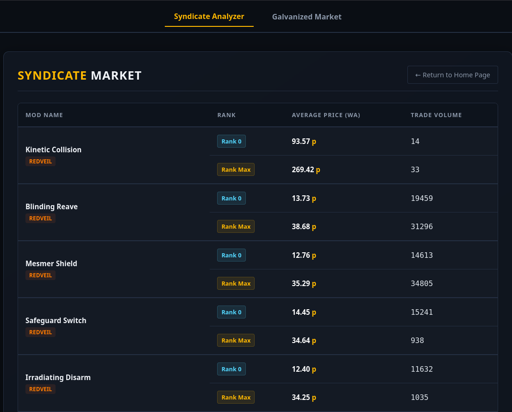
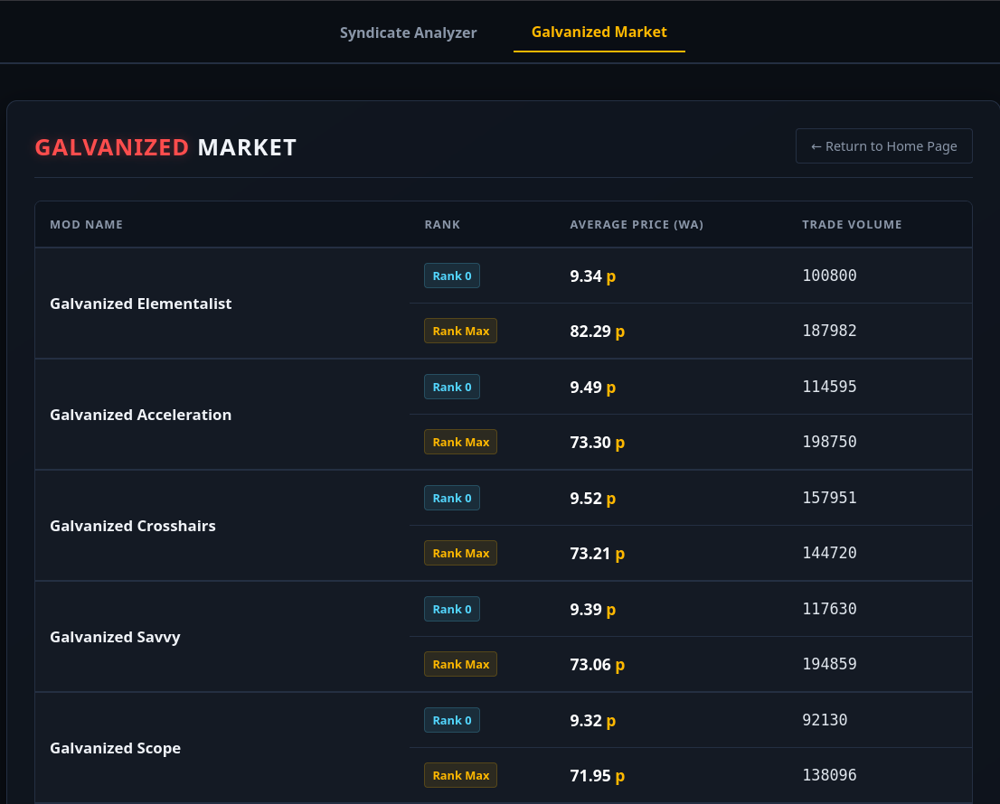

# Warframe Market Data Analyzer

## Project Overview
The **Warframe Market Data Analyzer** is a robust web-based tool designed to provide players with real-time economic insights into the Warframe in-game market. By leveraging external REST APIs, the application processes, filters, and visualizes complex market data, allowing users to make informed trading decisions regarding **Galvanized Mods** and **Syndicate-specific augments**.


## Core Functionality
The application provides two primary analytical modules:

* **Syndicate Market Analyzer:** Users can filter mod data by selecting specific Syndicates. The tool aggregates relevant augment mods and calculates statistical averages for pricing and trading volume.
* **Galvanized Mod Tracker:** A dedicated module providing a comprehensive overview of Galvanized Mod market performance, helping users track fluctuations between base and maximum rank pricing.

## Key Features
* **Real-Time Data Processing:** Fetches and normalizes live market data from the official Warframe Market API.
* **Dynamic Data Filtering:** Advanced backend logic to categorize and isolate items based on player-selected factions and mod attributes.
* **Statistical Analysis:** Calculates volume-weighted average pricing to provide accurate market valuations.
* **Responsive UI:** A clean, dark-mode-optimized interface built with Jinja2 templates and custom CSS, designed for high readability.

## Technologies Used
* **Backend:** Python 3.x, Flask (WSGI)
* **Deployment:** Gunicorn (Production-ready server)
* **Data Integration:** `requests` (API consumption)
* **Frontend:** HTML5, CSS3, Jinja2 Templating
* **Performance:** Implemented server-side caching to optimize API response times and adhere to rate-limiting policies.

## Installation and Setup
To run the project locally, follow these steps:

1. **Clone the repository:**
   ```bash
   git clone [https://github.com/your-username/warframe-market-analyzer.git](https://github.com/your-username/warframe-market-analyzer.git)
   cd warframe-market-analyzer
   ```
2. **Install the dependencies:**   
   ```bash
   pip install -r requirements.txt
   ```
3. **Run the main.py:**
   ```bash
   python main.py
   ```
4. **Navigate to the web page:**
    Open your web browser and navigate to http://127.0.0.1:5000


# UI








